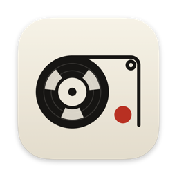
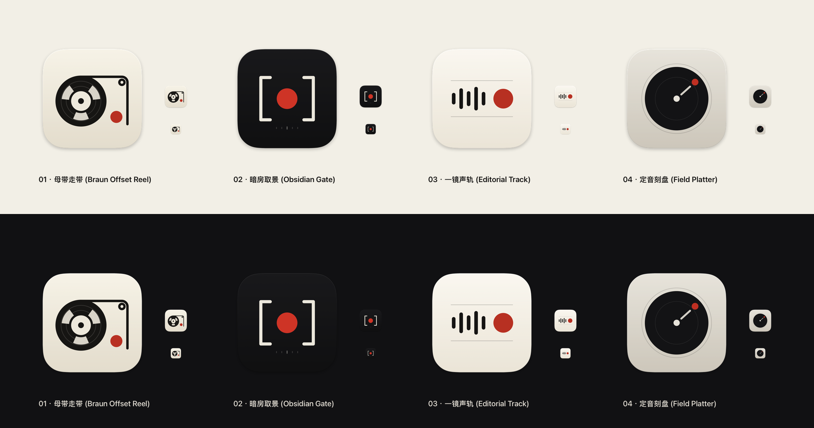

<p align="center">
  
</p>
<h1 align="center">LongTake</h1>
<p align="center">
  A crash-resilient, high-contrast Liquid Glass macOS screen &amp; dual-track audio recorder.<br/>
  Forked from <a href="https://github.com/lihaoyun6/QuickRecorder">QuickRecorder</a> under GNU AGPLv3.<br/>
  <a href="./README_zh.md">[简体中文]</a> · <a href="./docs/ARCHITECTURE.md">[Architecture &amp; Root-Cause Notes]</a>
</p>

---

## Why LongTake?

**LongTake** started from real-world failures recording long meetings and screen sessions on macOS (such as losing hours of system + microphone audio into a corrupt 28-byte `.m4a` header on quit or audio device changes). Every fix was engineered from first principles rather than surface patches.

### Core Reliability Fixes (Dual-Track Audio & Crash Resilience)
- **Synchronized Mic `AVAssetWriter` Finalization**: Waits deterministically (`DispatchGroup`) for `mic.m4a` `moov` atom completion before mixing `.qma` packages, plus 5-second `movieFragmentInterval` checkpoints and thread-safe serial system audio writing.
- **Isolated Offline `AVAudioEngine` Rendering**: Mixes `.qma` tracks through an isolated manual-rendering engine decoupled from physical audio hardware — switching headphones or Bluetooth devices mid-export will never hang CPU at 100%. Duration uses `max(sysFrames, micFrames)` normalized to 48 kHz.
- **Write-Ahead Atomic Staging + Crash Self-Healing**: Writes mixed outputs to `.longtake-staging-<UUID>.m4a`, validates non-zero readable frames, and atomically replaces the target path. Tracks all 4 async export pipelines with `.terminateLater` quit protection HUD and crash-only pending remux recovery.
- **Pause/Resume PTS & Timer Sync**: Deducts cumulative pause intervals across both system audio and microphone streams so long paused sessions stay lip-synced.
- **No Infinite Permission Retry Loops**: Checks `CGPreflightScreenCaptureAccess()` silently at startup instead of looping every second on `SCShareableContent`.

### Native macOS 26/27 Liquid Glass UI & Ergonomics
- **High-Contrast Single-Row Control Bar**: Unified horizontal bar placing the **Microphone toggle + native input device `Picker`** first, followed by 6 equal-height capture actions, `Preferences`, and `Close`.
- **User-Tunable Readability**: Adaptive paper/slate backing inside `GlassEffectContainer` + `.glassEffect(.regular)` (macOS 26+) with a live **Panel Background Opacity (25%–98%)** slider in Preferences.
- **Immediate AppKit Drag Grip**: Custom `WindowDragHandle` (`acceptsFirstMouse -> true`) lets you drag the floating bar on the very first press without activating it first.
- **Dual-Channel Recording Controller**:
  - **Borderless Top Floating Pill** (`FloatingHUDPanel`, `sharingType = .none` so it stays invisible in recordings) with fixed-width slots (`录制中`/`已暂停`, `暂停`/`继续`, `停止`) and collapse-to-menubar support.
  - **Single Native `NSMenu` Status Item**: Left-click toggles the main bar when idle and opens a safe native control menu while recording (eliminating accidental one-click stops).
- **Multi-Monitor Reopen Fixed**: Explicit `hidesOnDeactivate = false` and mouse-screen-aware reopening so clicking the Dock or Menu Bar icon reliably brings the panel back.

---

## Icon & Design Assets

LongTake ships a custom 2048px continuous-squircle icon (`Braun Offset Reel`). Four native SwiftUI candidates live in [`./design/`](./design) with an interactive preview ([`icon-playground.html`](./design/icon-playground.html)) and generator script ([`scripts/render_icons.swift`](./scripts/render_icons.swift)):

```bash
swift scripts/render_icons.swift --install 1   # choose variant 1..4
```

<p align="center">
  
</p>

---

## Build from Source

### Requirements
- macOS 12.3+ (Liquid Glass effects automatically activate on macOS 26+)
- Xcode (tested with Xcode 26.4 / MacOSX26.4.sdk)

### Quick Build & Install
> **Note**: Keep `PRODUCT_NAME = QuickRecorder` during `xcodebuild` so SwiftPM's `KeyboardShortcuts_KeyboardShortcuts.bundle` resource bundle resolves properly; set `CFBundleName` / `CFBundleDisplayName` to `LongTake` in `Info.plist` (already configured).

```bash
git clone https://github.com/HazelKahlil/LongTake.git
cd LongTake

xcodebuild -project QuickRecorder.xcodeproj -scheme QuickRecorder \
  -configuration Release -derivedDataPath build \
  CODE_SIGN_IDENTITY="-" CODE_SIGNING_REQUIRED=NO CODE_SIGNING_ALLOWED=NO build

# Optional: run offline audio pipeline self-check
swift scripts/verify-audio-pipeline.swift
```

To preserve macOS TCC Screen Recording & Microphone permissions across rebuilds on your own Mac, sign inside-out (`Sparkle.framework` helpers -> `Sparkle.framework` -> `KeyboardShortcuts` bundle -> `.app` with `QuickRecorder/QuickRecorder.entitlements`, without `--options runtime` for local dev certs) using your own `Apple Development` certificate in Keychain.

---

## License & Upstream Attribution

Modified by **HazelKahlil** in 2026 based on [lihaoyun6/QuickRecorder](https://github.com/lihaoyun6/QuickRecorder) (`e820517`).

This project is licensed under the **GNU Affero General Public License v3.0 (AGPL-3.0)** — see [`LICENSE`](./LICENSE) for full terms.

Thanks to upstream & open-source dependencies:
- [QuickRecorder](https://github.com/lihaoyun6/QuickRecorder) (@lihaoyun6)
- [Azayaka](https://github.com/Mnpn/Azayaka) (@Mnpn)
- [KeyboardShortcuts](https://github.com/sindresorhus/KeyboardShortcuts) (@sindresorhus)
- [SwiftLAME](https://github.com/hidden-spectrum/SwiftLAME) (@Hidden Spectrum)
