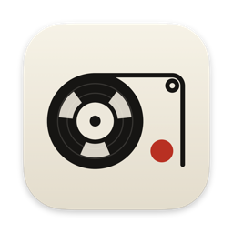
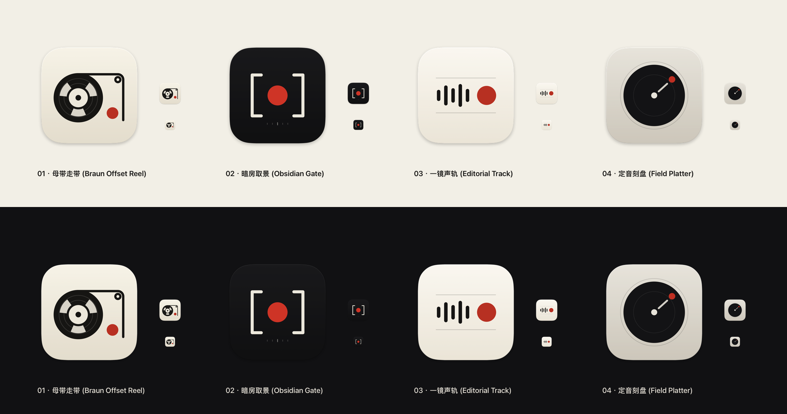

<p align="center">
  
</p>
<h1 align="center">LongTake</h1>
<p align="center">
  高可靠、高对比度原生 Liquid Glass macOS 录音与屏幕录制工具。<br/>
  基于 <a href="https://github.com/lihaoyun6/QuickRecorder">QuickRecorder</a>（<code>e820517</code>）重构，遵循 GNU AGPLv3 开源协议。<br/>
  <a href="./README.md">[English]</a> · <a href="./docs/ARCHITECTURE.md">[架构与根因审计文档]</a>
</p>

---

## 核心特性与根因级修复

**LongTake** 旨在彻底解决长时录音/录屏场景下的静默丢件、崩溃坏件与交互失灵问题：

### 1. 录音与导出全链路可靠性（彻底根治 28 字节空文件）
- **同步等待 `AVAssetWriter` 落盘**：`systemaudio` 停止录制时通过 `DispatchGroup` 同步等待麦克风轨完成 `moov` 索引写入，避免立即混音打开 44B 未封口文件；录制期启用 5 秒分片检查点与串行音频写入队列。
- **完全隔离的离线混音引擎**：导出 `.qma` 时新建独立离线 `AVAudioEngine`（不绑定物理输出设备），杜绝蓝牙/耳机切换导致的 100% CPU 死循环；双轨采样统一换算至 48 kHz 取最大时长，避免系统静音截断人声。
- **Write-Ahead 原子暂存与退出保护**：先写隐藏暂存文件并校验字节数与可读帧数 `> 0`，再原子替换至目标文件；4 条异步导出链路全量纳入 `.terminateLater` 退出保护（带悬浮提示 HUD）与异常退出后自愈队列。
- **暂停时长与双轨时间戳同步**：修复暂停恢复计时跳秒偏差，并在双轨系统录音模式下扣除累计暂停时长，多次暂停仍保持音画同步。
- **权限零骚扰策略**：启动改用静默 `CGPreflightScreenCaptureAccess()`，移除被拒后每秒递归重试逻辑，并禁用上游 Sparkle 自动更新以防覆盖本地构建。

### 2. 原生 macOS 26/27 Liquid Glass 界面与双通道控制
- **单行连贯高对比主控制栏**：将 **「录制麦克风 + 原生输入设备选择」** 独立置于最前端，接续 6 项等高采集动作、「偏好设置」与关闭按钮，彻底消除下方大块空白。
- **可调背景浓度（可读性）**：在 `GlassEffectContainer` + `.glassEffect(.regular)` 内层叠加自适应宣纸白 / 深灰母带衬底，并在「偏好设置 → 一般设置 → 界面外观」提供 **25%–98% 实时透明度滑杆**。
- **前置原生拖拽手柄**：最左侧点阵握把覆写 `acceptsFirstMouse`，非激活状态下首次按下即可直接拖动。
- **双通道录制控制器**：
  - **屏幕顶部无边框悬浮胶囊**：对录屏画面自动隐形（`sharingType = .none`），等字数固定槽位（`录制中` ↔ `已暂停`、`暂停` ↔ `继续`、`停止`）保证单行不换行、切换不抖动，支持一键收起至菜单栏。
  - **单一原生菜单栏 `NSMenu`**：空闲态点击开关主面板；录制态点击弹出原生菜单执行暂停、停止或重新呼出顶部胶囊，防止误触直接终止录制。
- **双屏与重开生命周期修复**：悬浮窗显式设定 `hidesOnDeactivate = false`，关闭主面板或停止录制后点击程序坞 / 菜单栏图标可在当前鼠标所在显示器稳定重开。

---

## 图标设计与一键切换

`./design/` 目录保留了基于原生 SwiftUI `ImageRenderer` 绘制的 4 组 2048px 连续超椭圆图标方案与交互式预览页面 [`icon-playground.html`](./design/icon-playground.html)，预设实装 `01 · 母带走带`：

```bash
swift scripts/render_icons.swift --install 1   # 可切换 1~4 号方案
```

<p align="center">
  
</p>

---

## 从源码构建

### 环境要求
- macOS 12.3 及以上（macOS 26+ 自动启用官方 Liquid Glass 组件）
- Xcode（已在 Xcode 26.4 / MacOSX26.4.sdk 验证通过）

### 编译命令
> **注意**：`xcodebuild` 请保留 `PRODUCT_NAME = QuickRecorder` 以保证 SPM 资源包 `KeyboardShortcuts_KeyboardShortcuts.bundle` 路径正常解析，实际应用名由 `Info.plist` 中的 `CFBundleName` / `CFBundleDisplayName = LongTake` 控制。

```bash
git clone https://github.com/HazelKahlil/LongTake.git
cd LongTake

xcodebuild -project QuickRecorder.xcodeproj -scheme QuickRecorder \
  -configuration Release -derivedDataPath build \
  CODE_SIGN_IDENTITY="-" CODE_SIGNING_REQUIRED=NO CODE_SIGNING_ALLOWED=NO build

# 可选：运行离线混音与原子落盘确定性自检
swift scripts/verify-audio-pipeline.swift
```

如需在本地覆盖安装并持久化 macOS TCC 录屏/麦克风权限，请使用个人钥匙串中的 `Apple Development` 证书由内向外签名（`Sparkle.framework` 内 XPC/Helper -> `Sparkle.framework` -> `KeyboardShortcuts` bundle -> 主程序带上 `QuickRecorder/QuickRecorder.entitlements`，不使用 `--options runtime`）。

---

## 开源协议与致谢

本项目由 **HazelKahlil** 于 2026 年基于 [lihaoyun6/QuickRecorder](https://github.com/lihaoyun6/QuickRecorder)（`e820517`）修改并开源，遵循 **GNU Affero General Public License v3.0 (AGPL-3.0)** 协议（详见 [`LICENSE`](./LICENSE)）。

致谢上游及依赖项目：
- [QuickRecorder](https://github.com/lihaoyun6/QuickRecorder) (@lihaoyun6)
- [Azayaka](https://github.com/Mnpn/Azayaka) (@Mnpn)
- [KeyboardShortcuts](https://github.com/sindresorhus/KeyboardShortcuts) (@sindresorhus)
- [SwiftLAME](https://github.com/hidden-spectrum/SwiftLAME) (@Hidden Spectrum)
